# API de negocio Django, HTTP y Swagger

## 1. Descripción

Esta carpeta contiene las evidencias del desarrollo y la verificación de la API de negocio implementada con Django y Django REST Framework para el proyecto EnlaceExpress.

Las capturas documentan el entorno de desarrollo, la organización del backend, la configuración de rutas, las migraciones, la ejecución del servidor, el funcionamiento de los endpoints HTTP, las respuestas JSON, la documentación OpenAPI mediante Swagger, las pruebas automatizadas y las consultas de solo lectura a la base de datos.

El objetivo es demostrar el funcionamiento de los componentes implementados mediante resultados reales, sin modificar los registros existentes durante las verificaciones de persistencia.

## 2. Evidencias

### 01. Entorno y dependencias

**Archivo:** `01-entorno-y-dependencias.png`

Muestra las versiones de Python y Django, junto con las dependencias principales utilizadas para desarrollar la API. Esta evidencia permite identificar las herramientas y bibliotecas instaladas en el entorno virtual del proyecto.

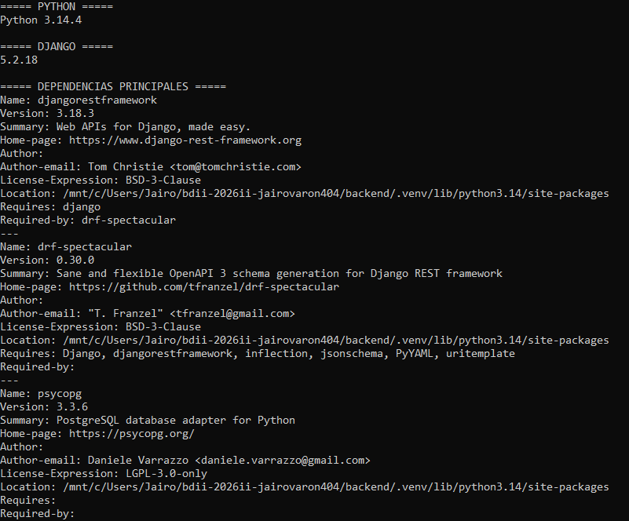

### 02. Estructura del backend

**Archivo:** `02-estructura-backend.png`

Presenta la organización de los directorios y archivos del proyecto. Permite identificar la separación entre la configuración de Django, la API, las aplicaciones del backend y los demás componentes del repositorio.

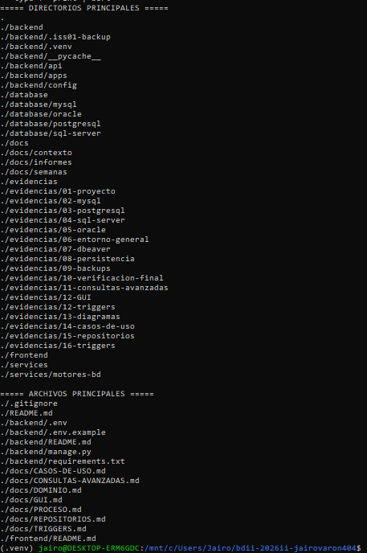

### 03. Configuración y comprobación

**Archivo:** `03-configuración-y-comprobación.png`

Muestra las rutas configuradas para el proyecto y la API, así como el resultado del comando `python manage.py check`. La comprobación permite verificar que Django no detecta problemas de configuración en el momento de la ejecución.

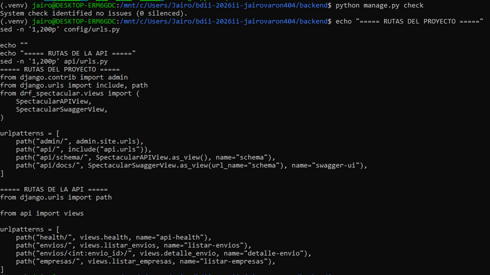

### 04. Migraciones aplicadas

**Archivo:** `04-migraciones-aplicadas.png`

Documenta el estado de las migraciones de Django, incluidas las aplicaciones `client` y `security`, además de las migraciones integradas del framework. Las migraciones marcadas con `[X]` indican que se encuentran aplicadas.

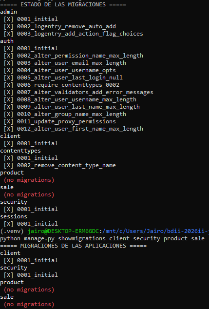

### 05. Servidor HTTP activo

**Archivo:** `05-servidor-http-activo.png`

Muestra el servidor de desarrollo de Django en ejecución. Esta evidencia permite comprobar que la aplicación puede iniciarse y atender solicitudes HTTP en el entorno local.

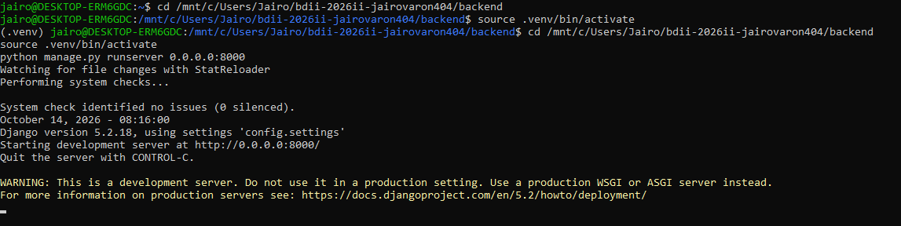

### 06. Endpoints HTTP funcionales

**Archivo:** `06-endpoints-http-funcionales.png`

Presenta solicitudes HTTP realizadas a los endpoints implementados, incluyendo el estado de salud de la API y las consultas de envíos y empresas. Los códigos HTTP permiten identificar el resultado de cada petición.

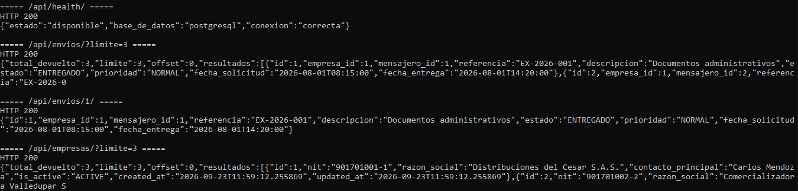

### 07. Respuestas JSON

**Archivo:** `07-respuestas-json.png`

Muestra ejemplos de las respuestas JSON devueltas por la API. Estas respuestas permiten verificar la estructura de los datos expuestos por los endpoints y comprobar que la información puede consultarse mediante solicitudes HTTP.

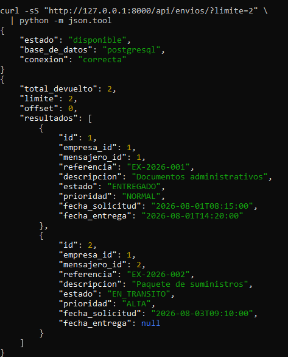

### 08. Swagger UI

**Archivo:** `08-swagger-ui.png`

Presenta la interfaz Swagger UI accesible desde `/api/docs/`. Esta interfaz permite consultar los endpoints documentados, revisar sus parámetros y visualizar los formatos de respuesta definidos en el esquema de la API.

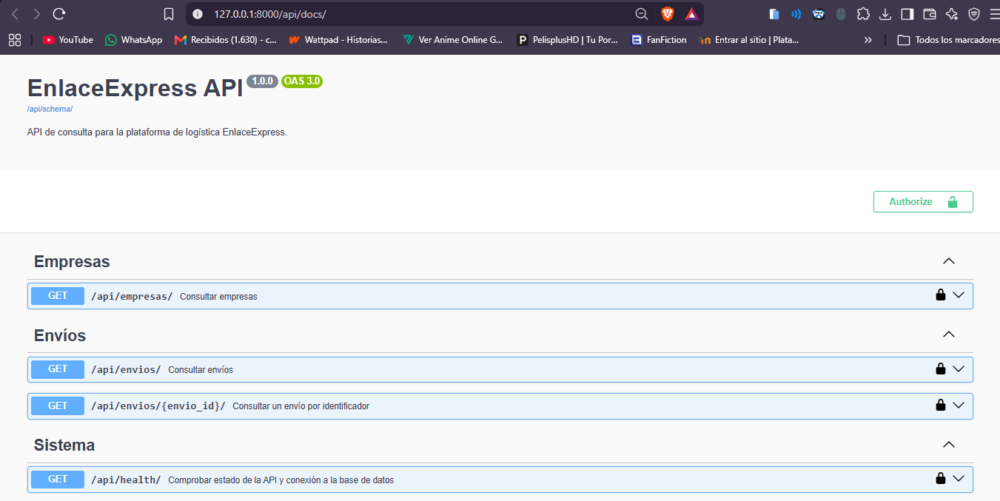

### 09. Esquema OpenAPI en JSON

**Archivo:** `09-esquema-openapi.json.png`

Muestra el esquema OpenAPI generado por la aplicación en formato JSON. Este documento describe las rutas, los métodos HTTP y la información necesaria para documentar y explorar la API de forma estandarizada.

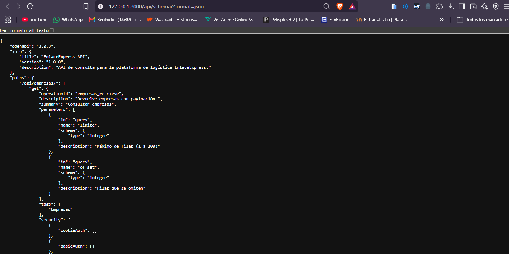

### 10. Pruebas automatizadas

**Archivo:** `10-pruebas-automatizadas.png`

Documenta la ejecución de las pruebas automatizadas disponibles para la API. La salida permite comprobar cuáles pruebas se ejecutaron y si finalizaron correctamente, de acuerdo con el resultado mostrado por Django.

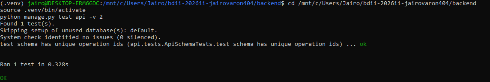

### 11. Base de datos y persistencia

**Archivo:** `11-base-de-datos-y-persistencia.png`

Presenta consultas de solo lectura para verificar la conexión con PostgreSQL, la existencia de las tablas de negocio y la disponibilidad de registros. Las consultas de esta evidencia no requieren insertar, actualizar ni eliminar datos.

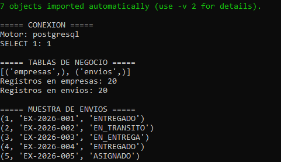

### 12. Validación de parámetros HTTP 400

**Archivo:** `12-validacion-parametros-400.png`

Muestra la respuesta de la API cuando se proporciona un parámetro de consulta inválido, como un valor no numérico para `limite`. La respuesta HTTP `400 Bad Request` indica que la solicitud contiene parámetros incorrectos.

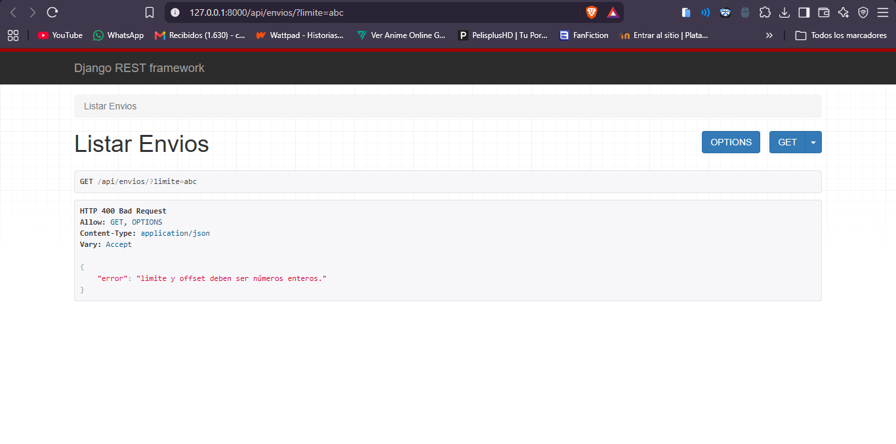

### 13. Recurso inexistente HTTP 404

**Archivo:** `13-recurso-inexistente-404.png`

Documenta la consulta de un envío cuyo identificador no existe. La respuesta HTTP `404 Not Found` permite comprobar que la API identifica los recursos inexistentes y comunica el resultado al cliente.

### 14. Estado de salud de la API en el navegador

**Archivo:** `14-health-api-navegador.png`

Muestra el endpoint `/api/health/` consultado desde el navegador. La respuesta permite verificar el estado reportado por la API y la conectividad con la base de datos en el momento de la consulta.

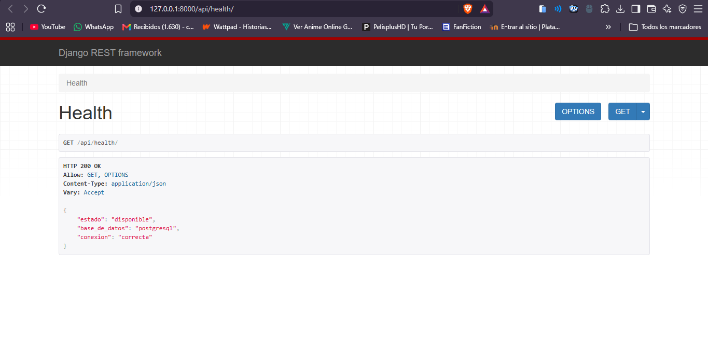

### 15. Estado final de Git

**Archivo:** `15-estado-final-git.png`

Presenta el estado del repositorio Git al finalizar la revisión, incluyendo la rama actual, los cambios pendientes y los últimos commits. Esta evidencia permite documentar el estado del código fuente durante la entrega.

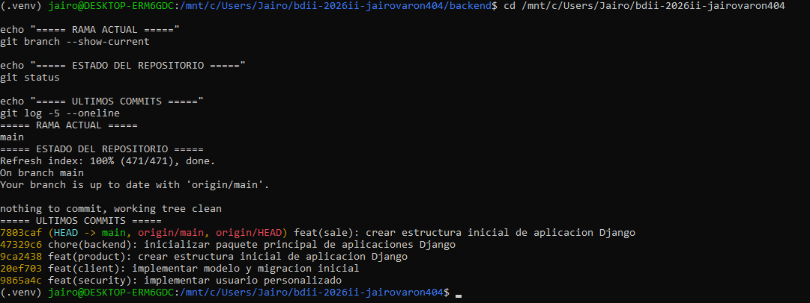

## 3. Consideraciones

- Las capturas corresponden a las verificaciones realizadas durante el desarrollo del proyecto.
- La API documentada expone los endpoints implementados y verificados en esta entrega.
- Las operaciones de consulta a la base de datos descritas en estas evidencias son de solo lectura.
- Los códigos HTTP documentados corresponden a los casos de prueba mostrados en las capturas.
- Swagger UI utiliza el esquema OpenAPI generado por la aplicación para presentar la documentación de los endpoints.
- Las evidencias respaldan únicamente los componentes y comportamientos que aparecen en las capturas; no implican que funcionalidades no implementadas hayan sido desarrolladas o probadas.
