# Documentación de Triggers — Enlace Express

## 1. Objetivo

Los triggers documentados automatizan la actualización de `updated_at` cuando se modifica una fila existente. Así, la fecha de última modificación se gestiona en la base de datos y no depende únicamente de la aplicación.

Se consideran diez tablas:
- `contactos`
- `direcciones`
- `empresas`
- `envios`
- `facturas`
- `mensajeros`
- `paquetes`
- `resource_roles`
- `resources`
- `rutas`

En MySQL también se han recopilado evidencias adicionales de triggers `AFTER INSERT` y `AFTER UPDATE` relacionados con envíos.

## 2. Funcionamiento general

Los triggers de auditoría temporal responden a `UPDATE` y asignan la fecha/hora actual a `updated_at` antes de guardar la fila.

En Oracle, las definiciones consultadas siguen este patrón:

```sql
BEFORE UPDATE ON nombre_tabla
FOR EACH ROW
BEGIN
    :NEW.updated_at := CURRENT_TIMESTAMP;
END;
```

En PostgreSQL, los diez triggers usan la función compartida `public.actualizar_updated_at()`, que asigna `CURRENT_TIMESTAMP` a `NEW.updated_at`.

> **Alcance de la evidencia:** un inventario demuestra que un trigger existe y muestra su estado; una consulta de definición permite revisar su lógica. Para demostrar su ejecución funcional, se debe actualizar una fila y comparar `updated_at` antes y después. Cuando sea apropiado, la prueba debe ejecutarse en una transacción que termine con `ROLLBACK`.

## 3. Inventario general

| N.º | Tabla | Trigger |
|---:|---|---|
| 1 | `contactos` | `trg_contactos_updated_at` |
| 2 | `direcciones` | `trg_direcciones_updated_at` |
| 3 | `empresas` | `trg_empresas_updated_at` |
| 4 | `envios` | `trg_envios_updated_at` |
| 5 | `facturas` | `trg_facturas_updated_at` |
| 6 | `mensajeros` | `trg_mensajeros_updated_at` |
| 7 | `paquetes` | `trg_paquetes_updated_at` |
| 8 | `resource_roles` | `trg_resource_roles_updated_at` |
| 9 | `resources` | `trg_resources_updated_at` |
| 10 | `rutas` | `trg_rutas_updated_at` |

## 4. MySQL

Se recopilaron evidencias para los diez triggers `updated_at` y dos evidencias adicionales relacionadas con eventos de envíos (`AFTER INSERT` y `AFTER UPDATE`). El efecto exacto de estos dos últimos debe describirse de acuerdo con sus definiciones SQL reales.

**Directorio:** `../evidencias/16-triggers/01-mysql/`

#### Trigger de contactos

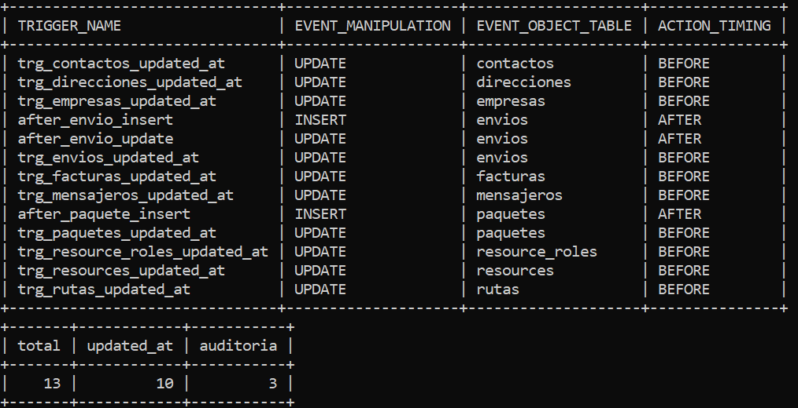

#### Trigger de direcciones

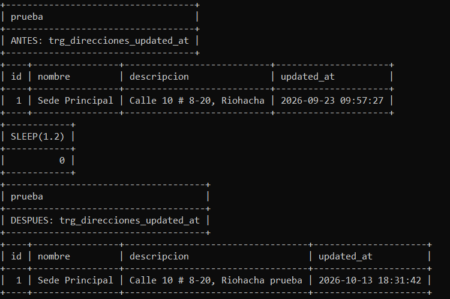

#### Trigger de empresas

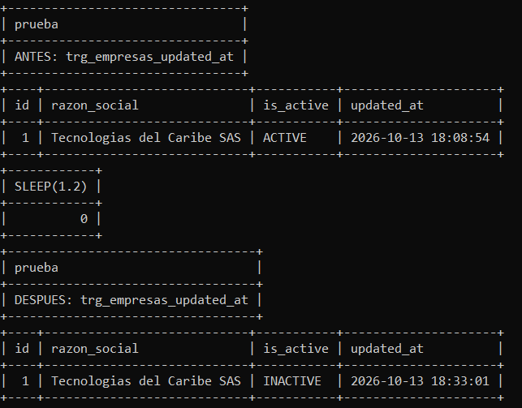

#### Trigger de envíos

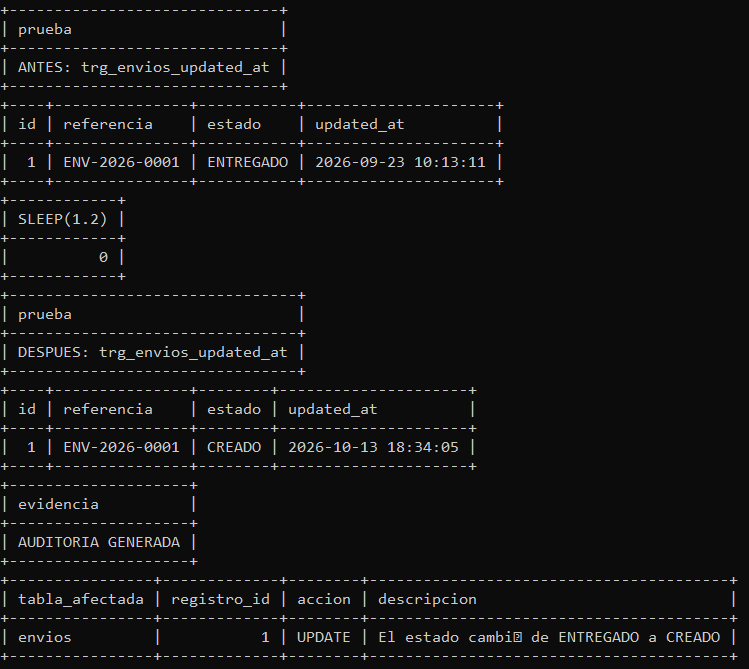

#### Trigger de facturas

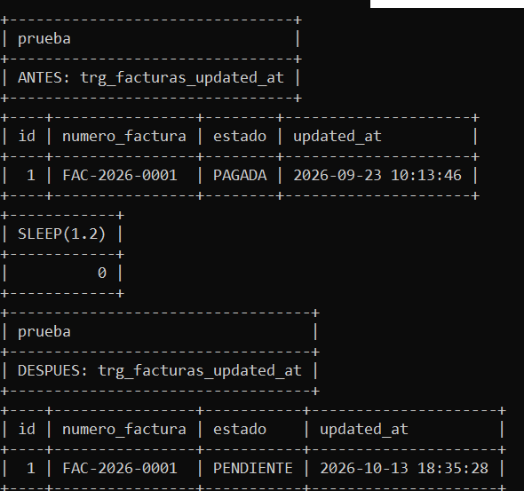

#### Trigger de mensajeros

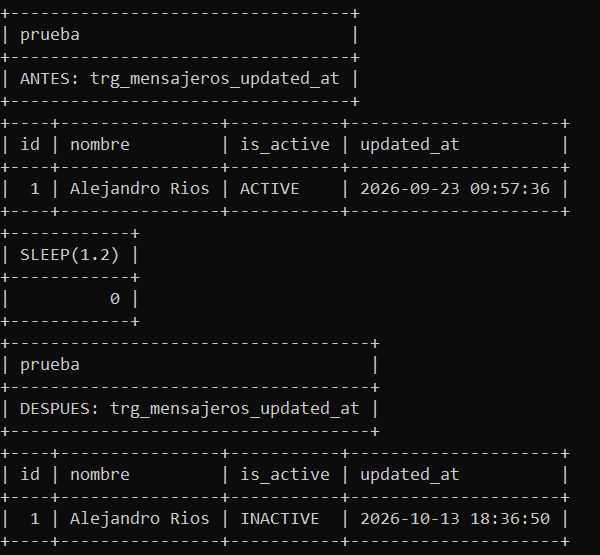

#### Trigger de paquetes

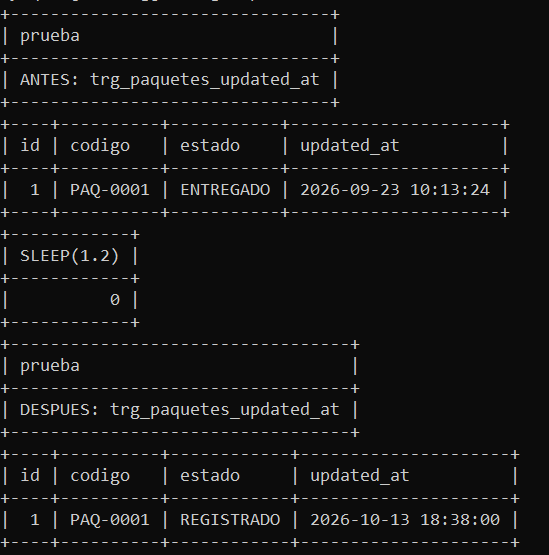

#### Trigger de resource_roles

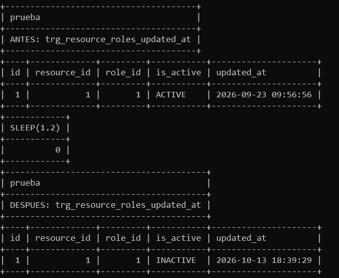

#### Trigger de resources

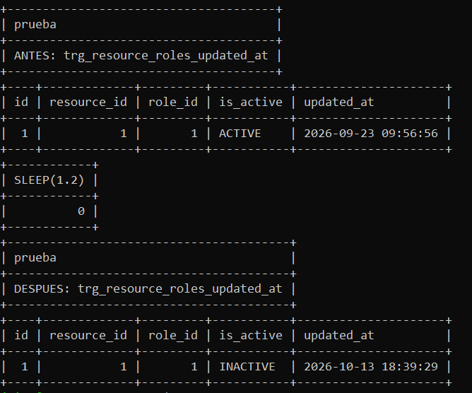

#### Trigger de rutas

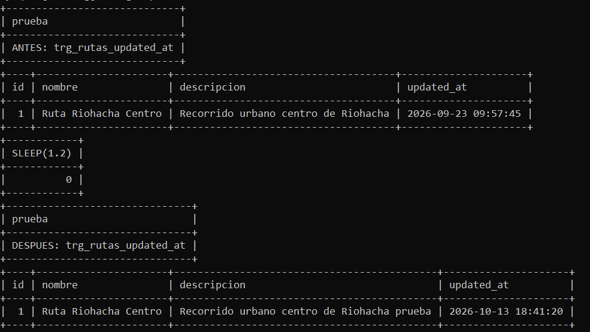

#### Trigger AFTER INSERT de envíos

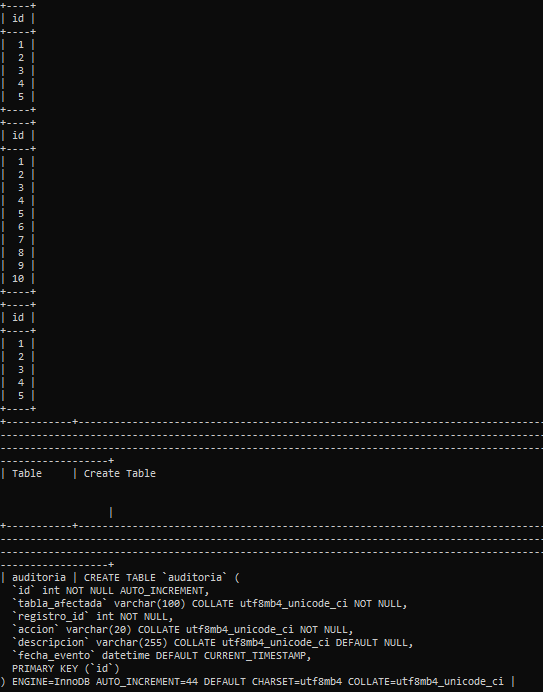

#### Trigger AFTER UPDATE de envíos

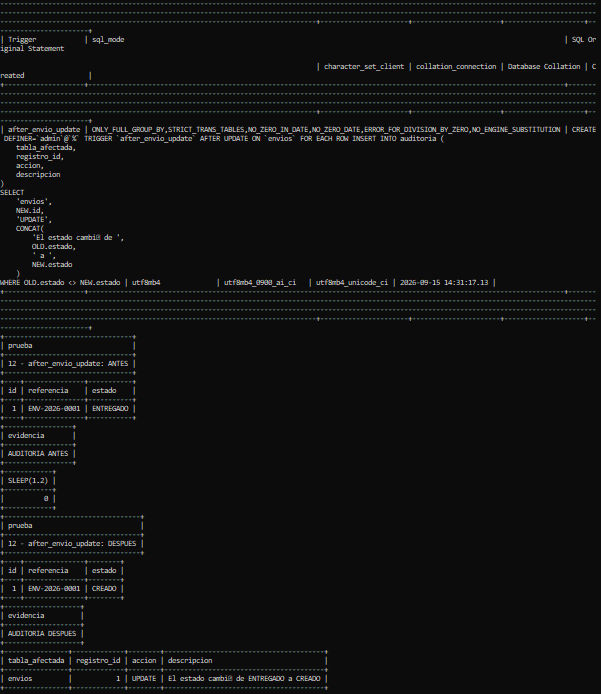

| Archivo | Evidencia |
|---|---|
| `01-trg_contactos_updated_at.png` | Trigger de contactos |
| `02-trg_direcciones_updated_at.png` | Trigger de direcciones |
| `03-trg_empresas_updated_at.png` | Trigger de empresas |
| `04-trg_envios_updated_at.png` | Trigger de envíos |
| `05-trg_facturas_updated_at.png` | Trigger de facturas |
| `06-trg_mensajeros_updated_at.png` | Trigger de mensajeros |
| `07-trg_paquetes_updated_at.png` | Trigger de paquetes |
| `08-trg_resource_roles_updated_at.png` | Trigger de asignaciones de roles a recursos |
| `09-trg_resources_updated_at.png` | Trigger de recursos |
| `10-trg_rutas_updated_at.png` | Trigger de rutas |
| `11-after_envio_insert.png` | Evidencia del evento `AFTER INSERT` en envíos |
| `12-after_envio_update.png` | Evidencia del evento `AFTER UPDATE` en envíos |

## 5. PostgreSQL

Los diez triggers `BEFORE UPDATE` reutilizan la función `public.actualizar_updated_at()`, que asigna la fecha y hora actuales a `NEW.updated_at`.

**Directorio:** `../evidencias/16-triggers/02-postgresql/`

#### Inventario de triggers

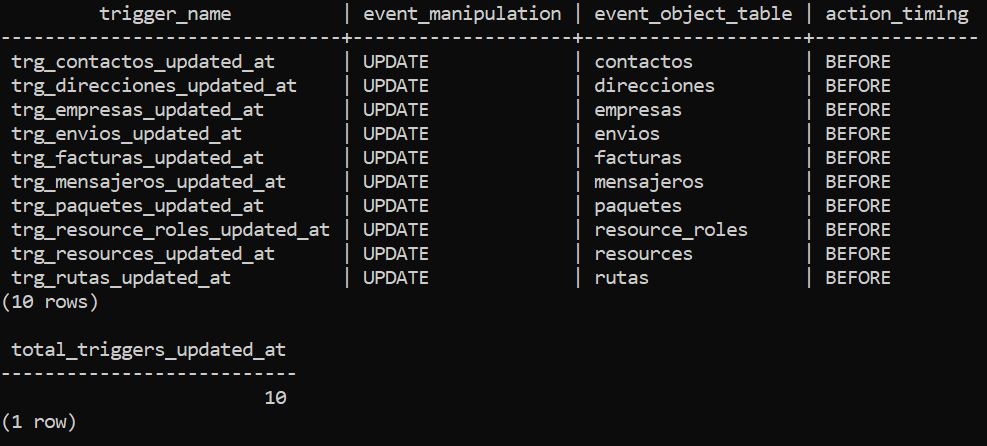

#### Trigger de contactos

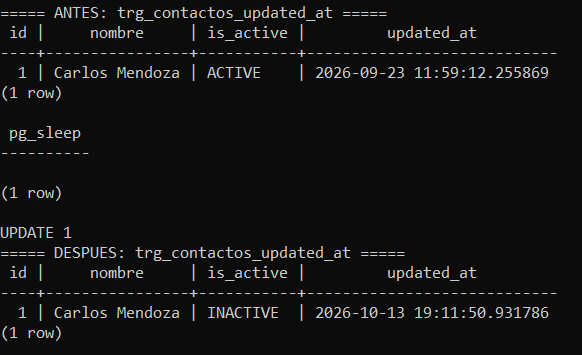

#### Trigger de direcciones

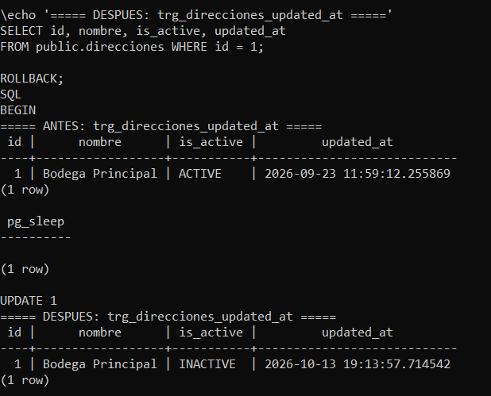

#### Trigger de empresas

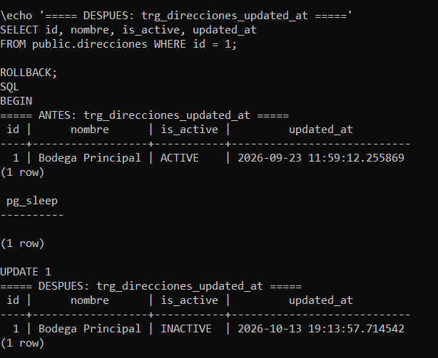

#### Trigger de envíos

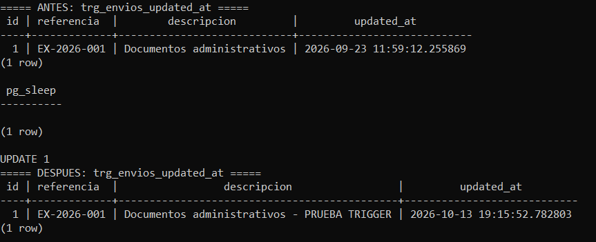

#### Trigger de facturas

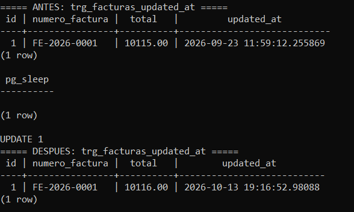

#### Trigger de mensajeros

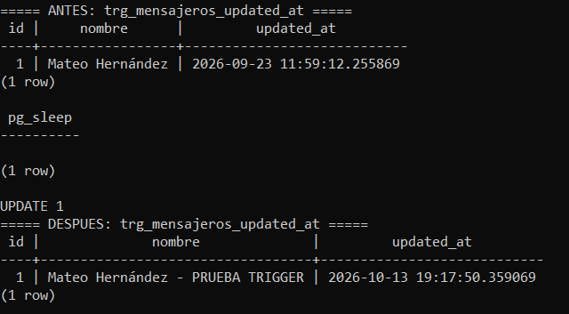

#### Trigger de paquetes

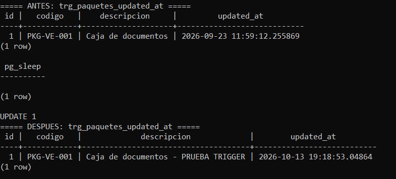

#### Trigger de resource_roles

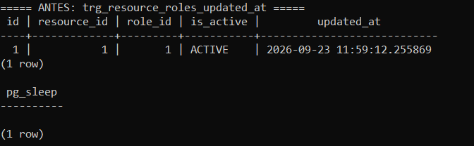

#### Trigger de resources

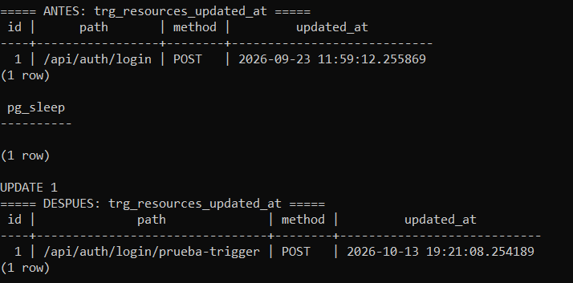

#### Trigger de rutas

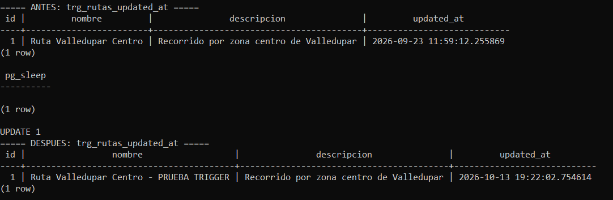

| Archivo | Evidencia |
|---|---|
| `01-inventario-triggers.png` | Inventario general |
| `02-trg_contactos_updated_at.png` | Trigger de contactos |
| `03-trg_direcciones_updated_at.png` | Trigger de direcciones |
| `04-trg_empresas_updated_at.png` | Trigger de empresas |
| `05-trg_envios_updated_at.png` | Trigger de envíos |
| `06-trg_facturas_updated_at.png` | Trigger de facturas |
| `07-trg_mensajeros_updated_at.png` | Trigger de mensajeros |
| `08-trg_paquetes_updated_at.png` | Trigger de paquetes |
| `09-trg_resource_roles_updated_at.png` | Trigger de asignaciones de roles a recursos |
| `10-trg_resources_updated_at.png` | Trigger de recursos |
| `11-trg_rutas_updated_at.png` | Trigger de rutas |

## 6. SQL Server

Se recopilaron evidencias de inventario y de los diez triggers asociados a las tablas indicadas. La implementación exacta debe consultarse en los archivos SQL del proyecto, en particular para confirmar cómo se procesan las filas afectadas por cada sentencia.

**Directorio:** `../evidencias/16-triggers/03-sql-server/`

#### Inventario de triggers

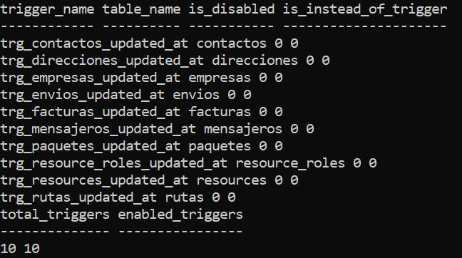

#### Trigger de contactos

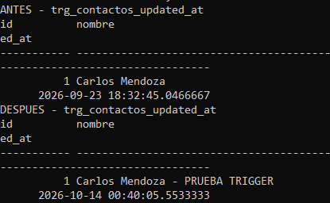

#### Trigger de direcciones

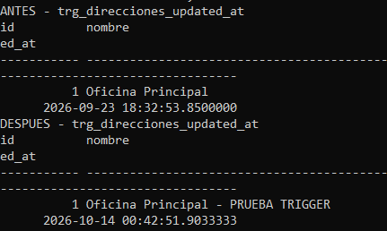

#### Trigger de empresas

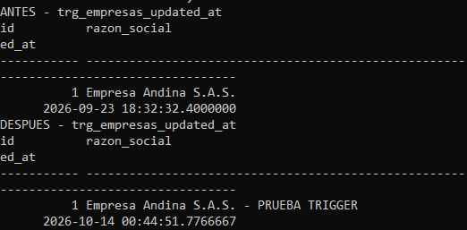

#### Trigger de envíos

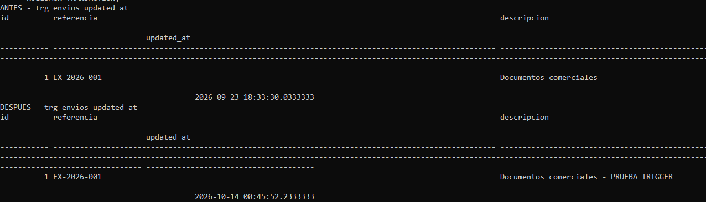

#### Trigger de facturas

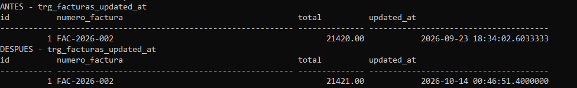

#### Trigger de mensajeros

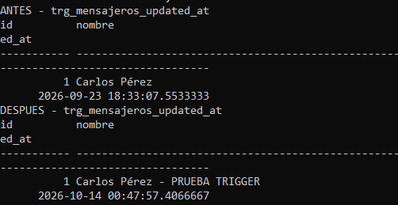

#### Trigger de paquetes

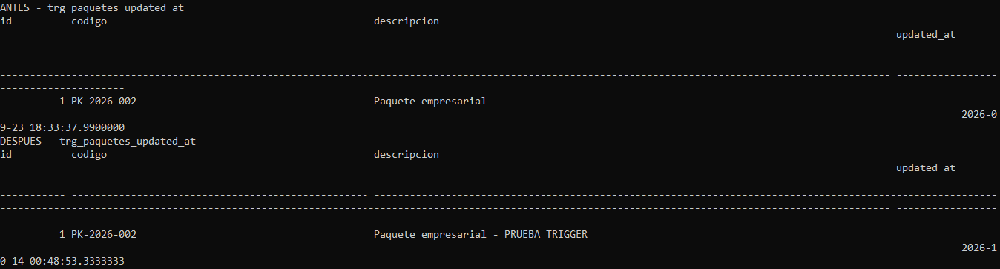

#### Trigger de resource_roles

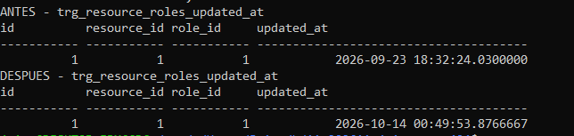

#### Trigger de resources

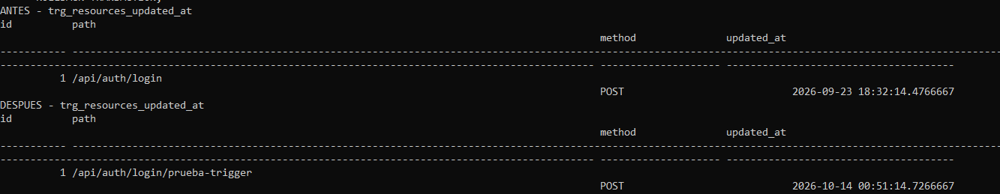

#### Trigger de rutas

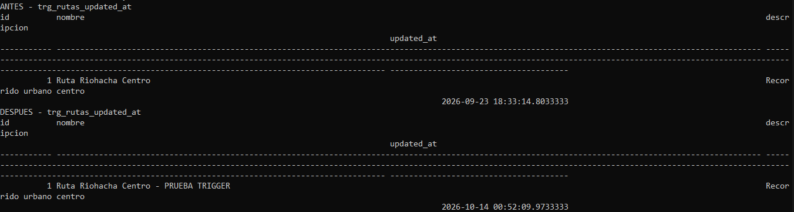

| Archivo | Evidencia |
|---|---|
| `01-inventario-triggers.png` | Inventario general |
| `02-trg_contactos_updated_at.png` | Trigger de contactos |
| `03-trg_direcciones_updated_at.png` | Trigger de direcciones |
| `04-trg_empresas_updated_at.png` | Trigger de empresas |
| `05-trg_envios_updated_at.png` | Trigger de envíos |
| `06-trg_facturas_updated_at.png` | Trigger de facturas |
| `07-trg_mensajeros_updated_at.png` | Trigger de mensajeros |
| `08-trg_paquetes_updated_at.png` | Trigger de paquetes |
| `09-trg_resource_roles_updated_at.png` | Trigger de asignaciones de roles a recursos |
| `10-trg_resources_updated_at.png` | Trigger de recursos |
| `11-trg_rutas_updated_at.png` | Trigger de rutas |

## 7. Oracle

En el contenedor Oracle, dentro del servicio/PDB `TECNOGUA` y el esquema `ENLACE_EXPRESS`, el inventario consultado mostró diez triggers en estado `ENABLED`. Todos responden a `UPDATE` y son `BEFORE EACH ROW`. Las definiciones consultadas asignan `CURRENT_TIMESTAMP` a `:NEW.updated_at`.

**Directorio:** `../evidencias/16-triggers/04-oracle/`

#### Inventario de triggers

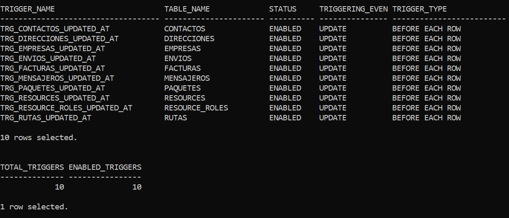

#### Trigger de contactos

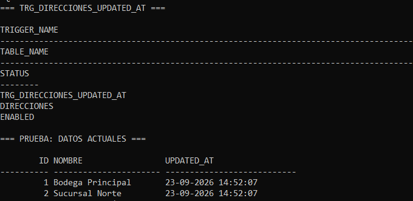

#### Trigger de empresas

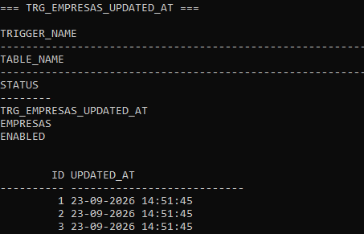

#### Trigger de envíos

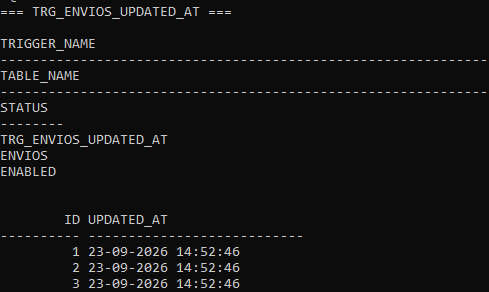

#### Trigger de facturas

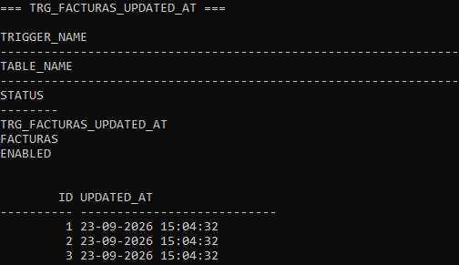

#### Trigger de mensajeros

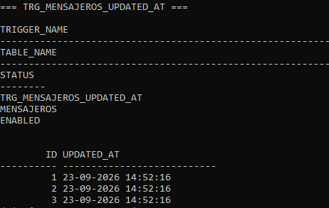

#### Trigger de paquetes

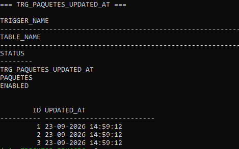

#### Trigger de resource_roles

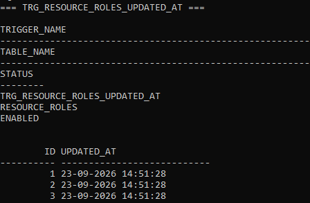

#### Trigger de resources

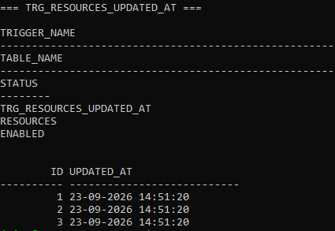

#### Trigger de rutas

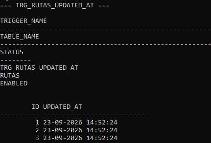

#### Archivo adicional de contactos: verificar si es duplicado

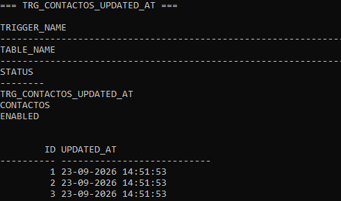

| Archivo | Evidencia |
|---|---|
| `01-inventario-triggers.png` | Inventario de triggers y estados |
| `02-trg_contactos_updated_at.png` | Trigger de contactos, según la numeración esperada |
| `03-trg_empresas_updated_at.png` | Trigger de empresas |
| `04-trg_envios_updated_at.png` | Trigger de envíos |
| `05-trg_facturas_updated_at.png` | Trigger de facturas |
| `06-trg_mensajeros_updated_at.png` | Trigger de mensajeros |
| `07-trg_paquetes_updated_at.png` | Trigger de paquetes |
| `08-trg_resource_roles_updated_at.png` | Trigger de asignaciones de roles a recursos |
| `09-trg_resources_updated_at.png` | Trigger de recursos |
| `10-trg_rutas_updated_at.png` | Trigger de rutas |
| `11-trg_contactos_updated_at.png` | Archivo adicional informado; verificar su contenido y renombrarlo o corregir el índice si es una captura duplicada |

**Observación de organización:** en el listado proporcionado para Oracle no aparece `02-trg_direcciones_updated_at.png`, y se informa un segundo archivo de contactos como `11-trg_contactos_updated_at.png`. Verifica los archivos reales para que la carpeta incluya la evidencia de direcciones y no tenga numeración duplicada o confusa.

## 8. Criterios de verificación

Para cada trigger, comprobar:

1. **Existencia:** aparece en el catálogo del motor.
2. **Estado:** está habilitado o activo.
3. **Evento:** responde a `UPDATE`.
4. **Definición:** asigna la fecha/hora actual a `updated_at`.
5. **Funcionamiento:** una prueba muestra el cambio de `updated_at` tras una actualización.
6. **Integridad:** las pruebas reversibles finalizan con `ROLLBACK` y no dejan datos de prueba.

Las capturas de inventario y consulta prueban la configuración observada. Solo las capturas que muestran el antes y después de una actualización deben presentarse como evidencia funcional.

## 9. Conclusión

Los triggers `updated_at` centralizan la actualización de la fecha de modificación de diez tablas de Enlace Express. La documentación reúne las evidencias de MySQL, PostgreSQL, SQL Server y Oracle. Las descripciones de comportamiento deben mantenerse alineadas con las definiciones SQL versionadas y con las pruebas realmente ejecutadas.
